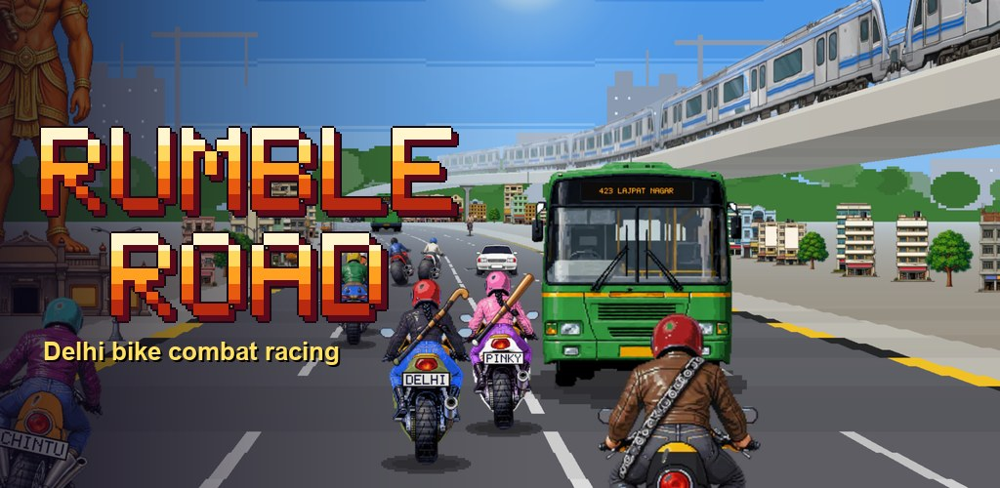
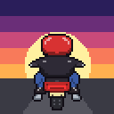
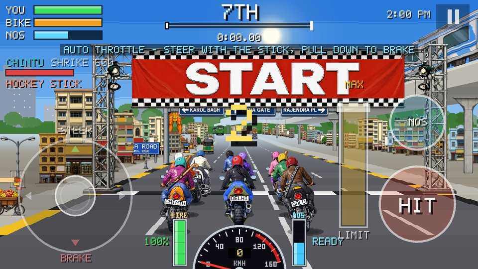
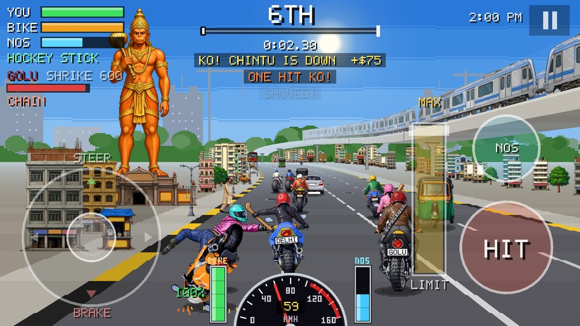
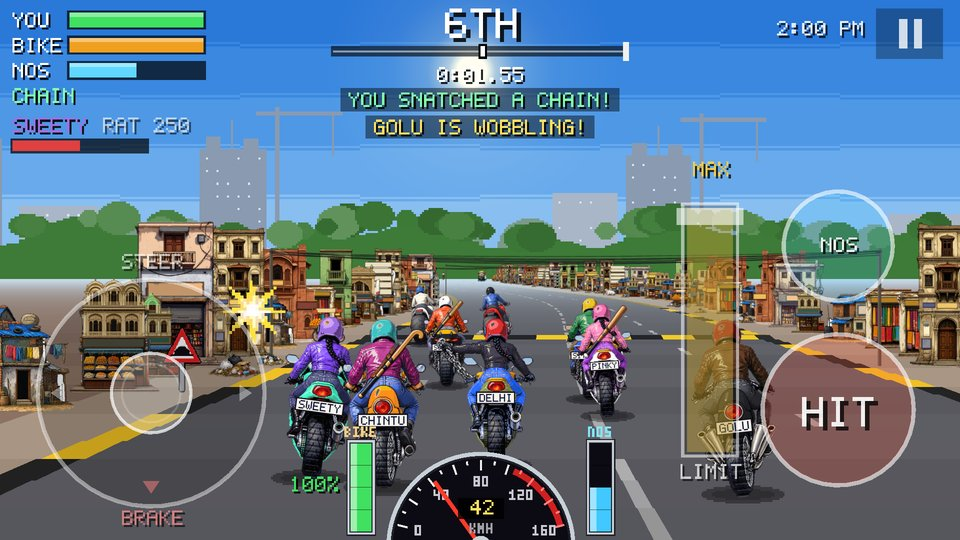
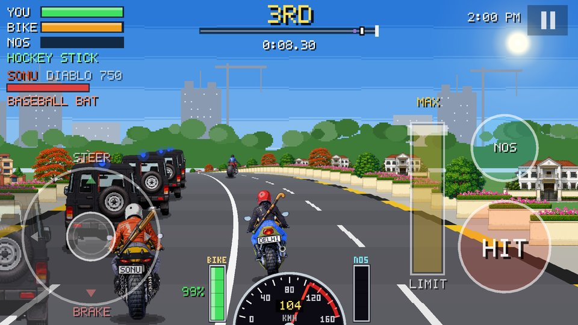
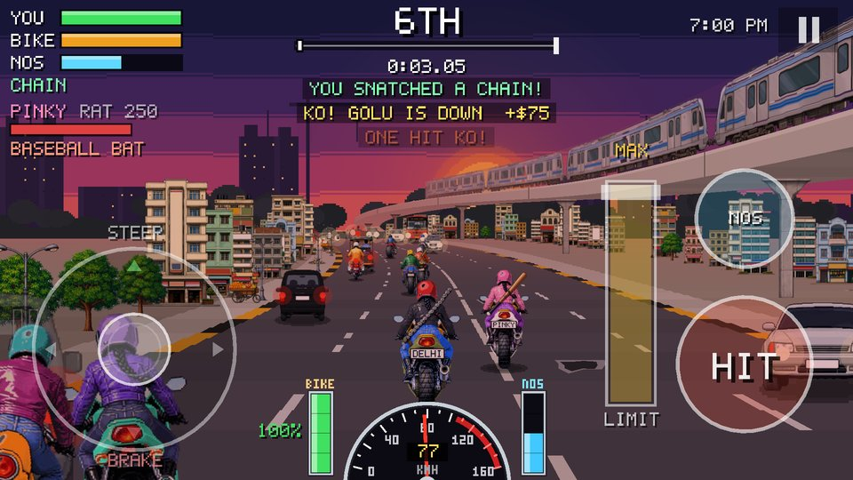
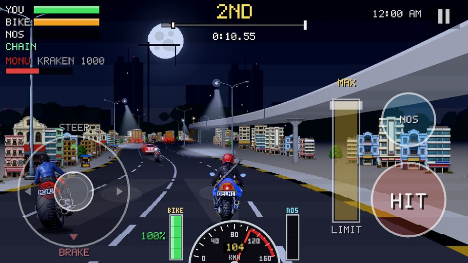
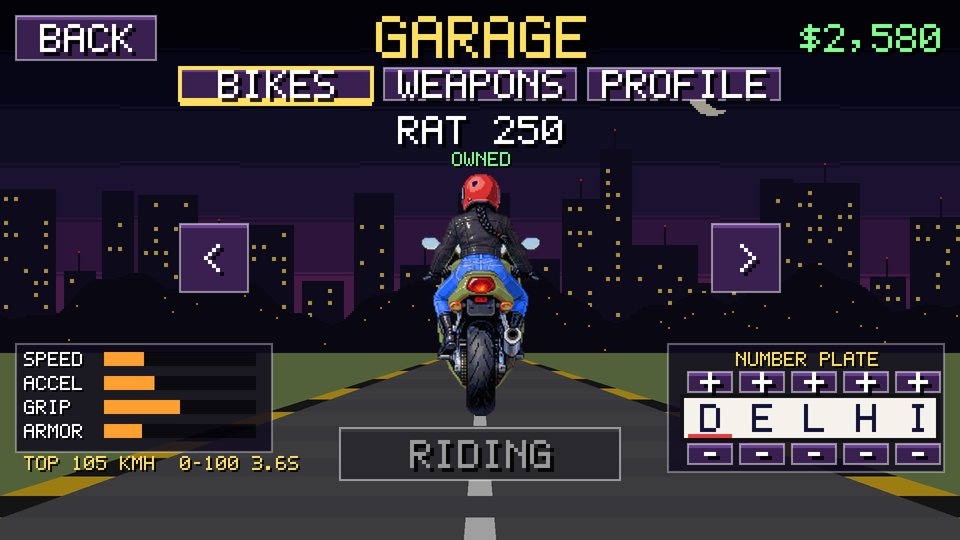
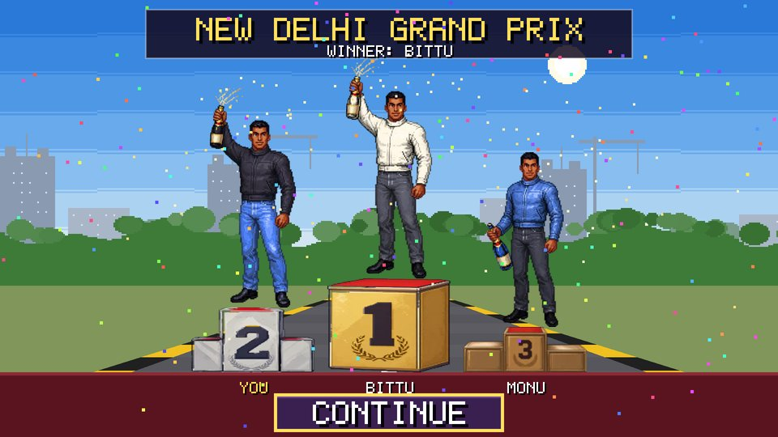

  

  

<h1 align="center">Rumble Road</h1>

  <b>Retro motorbike combat racing through the streets of New Delhi.</b> 
  Ride fast. Swing hard. Finish first.

  
  
  
  

  <a href="index.html"><b>Privacy Policy</b></a>
  &nbsp;·&nbsp;
  <a href="mailto:rishabhdahiya.work@gmail.com"><b>Contact</b></a>

---

## 🏍️ Race through real Delhi

Start on **Pusa Road** under the giant Hanuman statue, blast down **Kartavya Path** past **India Gate**, squeeze through the crowded lanes of **Chandni Chowk**, roar along the **Red Fort** wall, cruise the embassy avenues of **Chanakyapuri** and cross **Signature Bridge** to the finish, with the Delhi Metro thundering overhead.

  
  

## 🥊 Fight your way to the front

Punch rivals, or buy a **baseball bat, hockey stick or bike chain** in the garage and knock them off their bikes. The better the weapon, the better your chance of a one-hit KO. Knock out too many and **Inspector Singh** comes after you.

  
  

## 🌅 Three times of day

| Track | Vibe |
|---|---|
| **New Delhi** | A sunny 2 PM afternoon run |
| **Delhi Evening** | 7 PM rush hour, jam-packed roads, **double prize money** |
| **Delhi Midnight** | Empty roads, a full moon, flickering street lights and night trucks |

  
  

## 🔧 Garage, podium and secrets

Upgrade from the humble **Rat 250** to a café racer, a demon streetfighter and a monster power cruiser. Set your rider's name, look and number plate. Finish in the top three to spray the champagne on the podium, and keep an eye out for a couple of secrets along the route.

  
  

## 🎮 Made for touch

- Floating joystick to steer; the bike accelerates on its own
- Pull down halfway to cruise, all the way to brake
- Big **HIT** and **NITRO** buttons and an adjustable speed limiter
- Close calls fill your nitro meter

---

## 🔒 Privacy

Rumble Road has **no accounts and no sign-in**. Your progress is saved only on your phone. The game shows a small banner ad during races (Google AdMob). Read the full **[Privacy Policy](index.html)**.

## ✉️ Contact

Questions, feedback or privacy requests: **[rishabhdahiya.work@gmail.com](mailto:rishabhdahiya.work@gmail.com)**

This repository hosts the public privacy policy page (<code>index.html</code>, served by GitHub Pages) and this project page.

